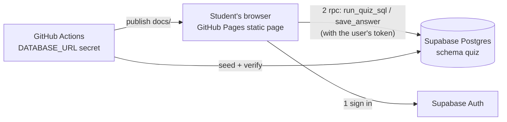

# IDS706 SQL Quiz (Supabase + GitHub Pages)

**Quiz site: https://luel-du.github.io/ids706-sql-quiz/**

A 20-point SQL quiz that runs against a live PostgreSQL database. A student signs in,
opens a question, writes SQL, runs it, and sees the rows. Everything is free-tier:
the database and sign-in live in Supabase, the page is static HTML on GitHub Pages,
and GitHub Actions seeds the database and verifies every answer key on each push.

Topic: a small **university registrar** with instructors, courses, students, and enrollments.

## How it works



1. The browser loads `docs/index.html` and signs the user in with Supabase Auth (email + password).
2. Every **Run** or **Save** is a call to a Postgres function through the Supabase REST API
   (`supabase-js` `rpc()`), carrying the signed-in user's token. The function checks `auth.uid()`,
   so a signed-out caller gets `permission denied` from the database itself, not just a disabled button.
3. The student's query is executed by an inner function that is **owned by a read-only role**
   (`quiz_reader`) with `SELECT` on the four quiz tables and nothing else. Writes, reads of other
   users' answers, the audit log, and other schemas all fail with `permission denied`.
4. Every run and save is appended to `quiz.audit_log`. A trigger blocks `UPDATE`/`DELETE` on that
   table, and no Row Level Security policy grants app roles any access to it.
5. On every push, GitHub Actions connects with the `DATABASE_URL` secret, re-applies the schema and
   seed, re-runs each question's expected SQL, and fails if any result differs from the stored hint.
   A second job writes the public Supabase URL and anon key into `docs/config.js` and deploys to Pages.

## Taking the quiz

1. Open the quiz URL above and click **Create account** (any email, password of 6+ characters).
   Email confirmation is off, so you are signed in immediately.
2. Pick a question on the left. Read the prompt.
3. Type SQL in the editor and click **Run**. Table names need no schema prefix
   (`select * from courses`). Only a single `SELECT`/`WITH` statement is accepted; results are capped at 200 rows.
4. Compare your result to **Show hint**, which reveals the expected SQL and the expected result table.
   The page also tells you when your result matches the expected answer exactly.
5. Click **Save answer** to store your SQL. Your latest saved answer per question is reloaded next time you sign in.
6. **My activity** shows your own audit-log entries.

### Tables

| Table | Columns | Keys |
| --- | --- | --- |
| `instructors` | id, name, department, hired_year | PK id |
| `courses` | id, code, title, credits, instructor_id | PK id, FK instructor_id → instructors |
| `students` | id, name, major, start_year | PK id |
| `enrollments` | id, student_id, course_id, term, grade_points | PK id, FK student_id → students, FK course_id → courses, UNIQUE (student_id, course_id, term) |

6 instructors, 10 courses, 15 students, 45 enrollments. All fictional. See `db/seed.sql`.

### Questions (5 × 4 points = 20)

| # | Pts | Skill | Question |
| --- | --- | --- | --- |
| 1 | 4 | WHERE, ORDER BY | List the code, title, and credits of every course worth 4 credits, ordered by code. |
| 2 | 4 | JOIN | Show each course title with the name of its instructor (`instructor`), sorted by instructor name, then title. |
| 3 | 4 | JOIN, GROUP BY, COUNT | How many students are enrolled in each course? Title and count (`students`), largest first, then title. |
| 4 | 4 | 3-table JOIN, AVG, ROUND | Average `grade_points` across each instructor's courses, rounded to 2 decimals (`avg_grade`), highest first, then name. |
| 5 | 4 | CTE / subquery, HAVING-style filter | Which students have earned more total credits than the average student? Name and `total_credits`, highest first, then name. |

Each question's expected SQL and expected result are stored in `quiz.questions` and shown in the hint.
Grading compares result sets, not SQL text.

## Repository layout

```
README.md
.env.example                 variable names only
.gitignore                   .env, docs/config.js, .venv/ are never committed
requirements.txt             psycopg2-binary, python-dotenv
db/schema.sql                schema quiz: tables, read-only role, functions, RLS, audit trigger (idempotent)
db/seed.sql                  data + the 5 questions with hint SQL and hint results (idempotent)
scripts/seed_and_verify.py   applies db/*.sql, verifies every hint, checks anon has no access
docs/index.html, app.js, styles.css   the GitHub Pages site
docs/config.example.js       template for the local config.js (CI generates the real one from secrets)
.github/workflows/ci.yml     seed-and-verify job, then deploy-pages job
```

## Setting it up from scratch

### 1. Supabase

1. Create a free project at https://supabase.com. Note the database password.
2. **Project Settings → Database → Connection string → Session pooler.** Copy the URI
   (`postgresql://postgres.<ref>:<password>@aws-0-<region>.pooler.supabase.com:5432/postgres`)
   and append `?sslmode=require`. This is `DATABASE_URL`.
3. **Project Settings → API.** Copy the Project URL (`SUPABASE_URL`) and the `anon` `public` key (`SUPABASE_ANON_KEY`).
4. **Authentication → Providers → Email.** Turn **Confirm email** off so students can sign up and start immediately.
   (Leave it on if you prefer; students then click a link in their inbox before signing in.)
5. **Authentication → URL Configuration.** Set Site URL to the quiz URL (optional, used for email links).

### 2. Local machine

```bash
git clone https://github.com/luel-du/ids706-sql-quiz.git
cd ids706-sql-quiz
python3 -m venv .venv && source .venv/bin/activate
pip install -r requirements.txt
cp .env.example .env            # fill in DATABASE_URL, SUPABASE_URL, SUPABASE_ANON_KEY
python scripts/seed_and_verify.py
```

Expected output ends with `Q1 OK` … `Q5 OK` and `RESULT: PASS`. The script applies `db/schema.sql` and
`db/seed.sql`, so this one command creates everything in the database. Use `--verify-only` to skip the apply.

To test the page locally:

```bash
cp docs/config.example.js docs/config.js   # fill in the URL and anon key
python -m http.server -d docs 8000          # open http://localhost:8000
```

### 3. GitHub

1. Push the repo to GitHub.
2. **Settings → Secrets and variables → Actions → New repository secret**, three times:
   `DATABASE_URL`, `SUPABASE_URL`, `SUPABASE_ANON_KEY`.
3. **Settings → Pages → Source: GitHub Actions.**
4. Push to `main` (or run the **CI** workflow manually). The first job prints the connection target
   (password masked by GitHub), applies schema and seed, and verifies the five hints. The second job deploys the site.

## Security notes

| Concern | Mechanism |
| --- | --- |
| Signed-out users cannot run or save | `EXECUTE` on the five public functions is granted to `authenticated` only and revoked from `anon`/`public`; each function also raises if `auth.uid()` is null |
| Student SQL cannot modify data | Executed by `quiz.exec_readonly()`, a `SECURITY DEFINER` function owned by `quiz_reader`, a `NOLOGIN` role with `SELECT` on the four data tables only. Only a single `SELECT`/`WITH` statement is accepted; semicolons are rejected |
| Students cannot read each other's answers | `submissions` and `audit_log` have RLS enabled and forced, with no policies for app roles; access is only through functions that filter on `auth.uid()` |
| Audit log cannot be altered | `BEFORE UPDATE OR DELETE` trigger raises an exception, even for the table owner |
| No SQL injection in our code | Browser calls use `rpc()` with named parameters; the CI script uses psycopg2 `%s` parameters. The only dynamic SQL is the student's own query, which is the sandboxed feature itself |
| Runaway queries | Supabase's default `statement_timeout` for the `authenticated` role (8 s) applies; results are capped at 200 rows |
| Secrets | The database password exists only in a local `.env` (git-ignored) and in a GitHub Secret. The browser receives only the anon key, which is public by design |

## Extra credit implemented

- **Parameterized queries**: all application queries use `rpc()` named arguments or psycopg2 parameters; no f-string SQL.
- **Audit log**: `quiz.audit_log` records user, email, action (run/save), question, SQL text, row count, success flag, and error for every run and save.
- **Integrity check**: the taker role has no `UPDATE`/`DELETE` path to the log (no RLS policy, no grant), and a trigger refuses those operations for every role.

## Troubleshooting

- `permission denied for function run_quiz_sql` in the browser: you are signed out. Sign in.
- `Missing config.js`: locally, copy `docs/config.example.js` to `docs/config.js`; in CI, check the two `SUPABASE_*` secrets.
- CI fails with `DATABASE_URL is not set`: add the secret. Fails on connect: make sure the URL is the **Session pooler** one with `?sslmode=require`.
- `Q3 MISMATCH`: seed data and a hint drifted. Fix `db/seed.sql` (data or hint JSON) and push again.
